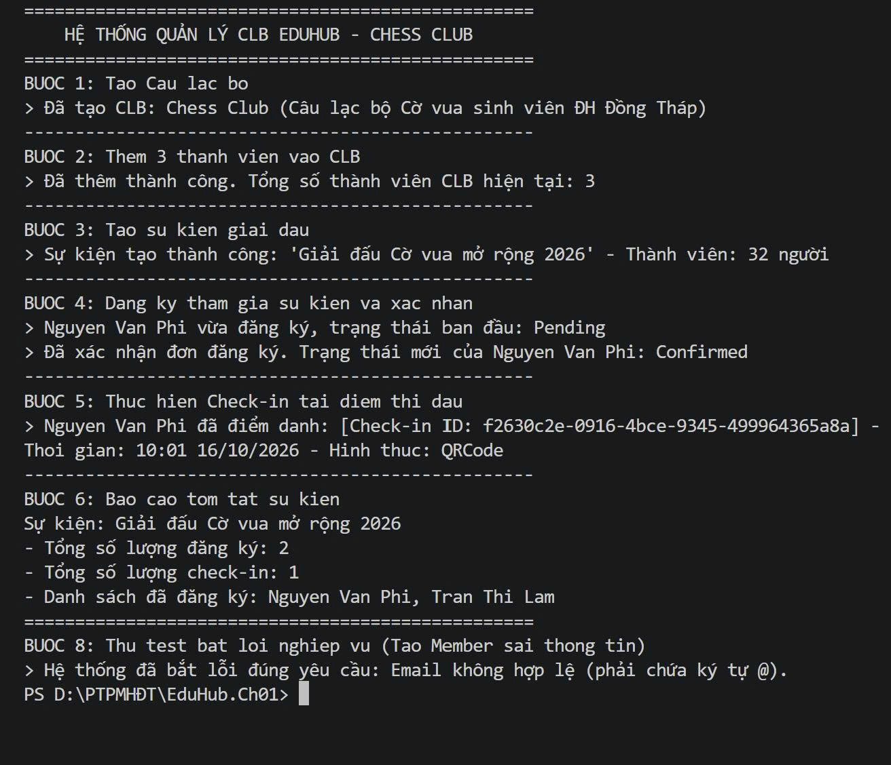

# EduHub - Hệ thống Quản lý Câu lạc bộ Cờ vua
**Sinh viên:** Thái Thị Hồng Trang

**MSSV:** 0024419352

## 1. Mô tả thiết kế Domain
Hệ thống được thiết kế theo hướng đối tượng gồm 5 class chính:
- **Member**: Đại diện cho sinh viên tham gia câu lạc bộ.
- **Club**: Đại diện cho Câu lạc bộ Cờ vua, nơi quản lý danh sách thành viên và tạo sự kiện.
- **Event**: Sự kiện giải đấu cờ vua do CLB tổ chức.
- **Registration**: Phiếu đăng ký tham gia thi đấu của thành viên.
- **CheckIn**: Hệ thống ghi nhận điểm danh khi thành viên đến khu vực thi đấu.

## 2. Hướng dẫn chạy ứng dụng
Để chạy chương trình demo quy trình hoạt động của câu lạc bộ Cờ vua:
1. Mở Terminal trong Visual Studio Code.
2. Đảm bảo đường dẫn đang ở đúng thư mục chứa project: `EduHub.Ch01`.
3. Gõ câu lệnh sau để chạy:
   ```bash
   dotnet run  
## 3. Kết quả chạy
